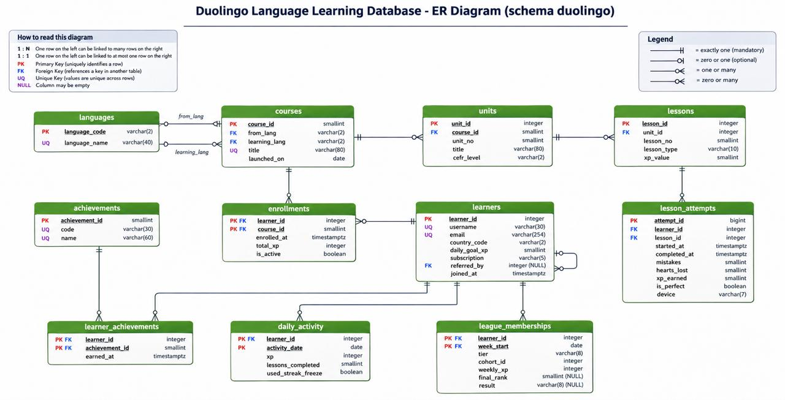
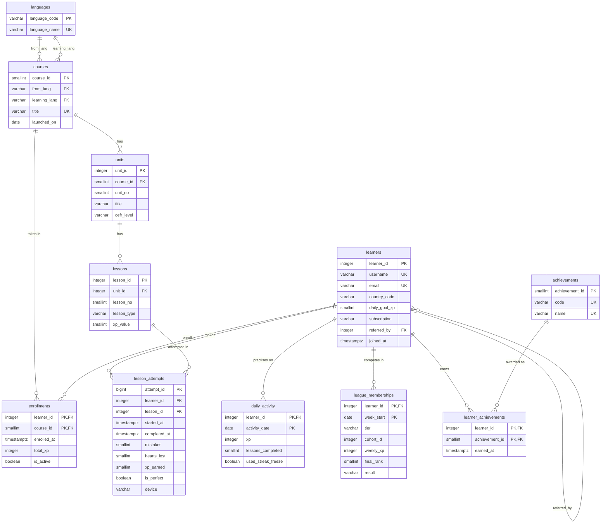

# Schema Design: Duolingo Language Learning Database

**Team:** T0097 · **Database:** PostgreSQL 18.6 · **Schema:** `duolingo`  
**Phase 2 deliverable:** data dictionary, ER diagram, functional dependencies and normal forms, load results, integrity-check results, and data problems found.

**Contents:** Overview · 1 Data dictionary · 2 ER diagram · 3 Functional dependencies and normal forms · 4 Derived and redundant columns · 5 Load results · 6 Integrity checks · 7 Data problems found

---

## Overview

The schema is reconstructed from the 11 supplied CSV files in `seed_data/`. It uses the schema `duolingo` and retains the exact table names and column names required by the project workload. The design uses primary keys, foreign keys, `UNIQUE`, `NOT NULL`, and `CHECK` constraints. No manually created performance indexes are added in this phase; only indexes created automatically by primary-key and unique constraints are present.

## How to run

```bash

unzip seed_data.zip                       # creates seed_data/ (git-ignored)

createdb duolingo

psql -d duolingo -v ON_ERROR_STOP=1 -f sql/01_schema.sql

psql -d duolingo -v ON_ERROR_STOP=1 -f sql/02_load_data.sql   # run from the project root

```

All 11 files load with no errors in about 4 s. All 30 queries in `queries/workload_30.sql` run on this schema without changes.

## How we worked out the schema

We did not guess the schema. We first loaded every CSV into a scratch database with every column as `text`. Then for every column we measured NULL counts, distinct values, min/max and length. We also tested every candidate key and every business rule with `SELECT count(*) … WHERE <rule is broken>`. A constraint went into `01_schema.sql` only when the seed data obeyed it 100 % **and** the business needs it. Rules that the business needs but the data breaks are listed under [Data problems found](#data-problems-found).

---

## 1. Data dictionary

### Type choices that apply to every table

| Kind of value | Type | Why |
|---|---|---|
| Surrogate ids of small catalogues (courses, achievements) | `smallint` | 11 and 10 rows. They will never pass 32 767. |
| Ids of larger tables (units, lessons, learners, cohorts) | `integer` | Learners will grow 20× to about 600 k. `integer` goes up to 2.1 billion. |
| `lesson_attempts.attempt_id` | `bigint` | This is the fastest-growing table. The ids already jump to 11 199 068 (see DP9), and W01 inserts 90 000 001. |
| Small counts (mistakes, hearts, XP per attempt, ranks, positions) | `smallint` | Values are 0–100, and the type saves 2 bytes per row on the biggest table. |
| XP totals (`total_xp`, `daily_activity.xp`, `weekly_xp`) | `integer` | These are sums that grow over time. |
| Moments in time (`joined_at`, `started_at`, …) | `timestamptz` | The export carries a `+05:30` offset. `timestamptz` keeps the exact instant and lets India-day logic work. The database time zone is set to `Asia/Kolkata`. |
| Calendar days (`activity_date`, `week_start`, `launched_on`) | `date` | These have no time-of-day part. |
| Yes/no (`is_active`, `is_perfect`, `used_streak_freeze`) | `boolean` | The CSV holds `t`/`f`. Queries test them as booleans (`WHERE d.used_streak_freeze`). |
| Codes with a fixed set of values (tier, device, subscription, …) | `varchar(n)` + `CHECK (… IN …)` | Easy to extend with `ALTER TABLE`, unlike `ENUM`. It also gives readable CHECK errors. |
| Two-letter codes | `varchar(2)` + regex CHECK | We use this instead of `char(2)` because `char` pads with blanks. |
| Money | none | The export has no money column. Subscription is only a tier name. |

### languages (10 rows)

| Column | Type | Constraints | Why |
|---|---|---|---|
| language_code | varchar(2) | **PK**, CHECK `^[a-z]{2}$` | ISO 639-1 codes are short, stable and unique, so a 2-letter natural key is fine. It also makes `courses.from_lang = 'en'` readable without a join (R01). |
| language_name | varchar(40) | NOT NULL, UNIQUE, CHECK not blank | Two languages cannot share a name. |

### courses (11)

| Column | Type | Constraints | Why |
|---|---|---|---|
| course_id | smallint | **PK**, CHECK > 0 | Surrogate id used by every child table. |
| from_lang | varchar(2) | NOT NULL, **FK → languages** ON DELETE RESTRICT | The language you speak. You cannot delete a language that still has courses. |
| learning_lang | varchar(2) | NOT NULL, **FK → languages** ON DELETE RESTRICT, CHECK `from_lang <> learning_lang` | Learning English from English is not a course. |
| title | varchar(80) | NOT NULL, UNIQUE | Titles are unique in the data, and R18 groups by `title`, so uniqueness makes that GROUP BY equal to grouping by course. |
| launched_on | date | NOT NULL, CHECK ≥ 2011-01-01 | Duolingo did not exist before 2011. |
| (from_lang, learning_lang) | | **UNIQUE** | One course per language pair. This is the natural key. |

### units (220)

| Column | Type | Constraints | Why |
|---|---|---|---|
| unit_id | integer | **PK** | Surrogate id. |
| course_id | smallint | NOT NULL, **FK → courses** ON DELETE CASCADE | A unit cannot exist without its course (composition). |
| unit_no | smallint | NOT NULL, CHECK > 0 | Position in the course path (1–20). |
| title | varchar(80) | NOT NULL | The same titles repeat across courses ("Basics"), so this is **not** unique. |
| cefr_level | varchar(2) | NOT NULL, CHECK IN (A1, A2, B1, B2, C1, C2) | The six CEFR levels. The data uses A1–C1, and C2 is allowed for future units. |
| (course_id, unit_no) | | **UNIQUE** | The natural key: a position inside a course. |

### lessons (1 760)

| Column | Type | Constraints | Why |
|---|---|---|---|
| lesson_id | integer | **PK** | Surrogate id, referenced by attempts. |
| unit_id | integer | NOT NULL, **FK → units** ON DELETE CASCADE | Composition, like units. |
| lesson_no | smallint | NOT NULL, CHECK > 0 | Position in the unit (1–8). |
| lesson_type | varchar(10) | NOT NULL, CHECK IN (LEARN, PRACTICE, STORY, LEGENDARY) | These are the only four types. |
| xp_value | smallint | NOT NULL, CHECK 0 < xp ≤ 100 and multiple of 5 | XP for finishing the lesson (10/15/20/40). |
| (unit_id, lesson_no) | | **UNIQUE** | **What identifies a lesson inside a unit** is its position. This is the natural key. |

### achievements (10)

| Column | Type | Constraints | Why |
|---|---|---|---|
| achievement_id | smallint | **PK** | |
| code | varchar(30) | NOT NULL, UNIQUE, CHECK `^[A-Z][A-Z0-9_]\*$` | W05 looks the badge up by `code = 'XP_100'`, so the code must be unique. |
| name | varchar(60) | NOT NULL, UNIQUE | Display name. |

### learners (30 000)

| Column | Type | Constraints | Why |
|---|---|---|---|
| learner_id | integer | **PK** | |
| username | varchar(30) | NOT NULL, UNIQUE, CHECK `^[A-Za-z][A-Za-z0-9_]{2,29}$` | The sign-in handle (R11). It is also unique ignoring case in the data. |
| email | varchar(254) | NOT NULL, UNIQUE, CHECK lower-case email format | 254 is the RFC maximum. The lower-case rule stops `A\@x.com` and `a\@x.com` from both being stored. |
| country_code | varchar(2) | NOT NULL, CHECK `^[A-Z]{2}$` | ISO 3166 alpha-2 (IN, US, GB, AE, NP). |
| daily_goal_xp | smallint | NOT NULL, DEFAULT 10, CHECK IN (10, 20, 30, 50) | The four goals the app offers (Casual / Regular / Serious / Intense). |
| subscription | varchar(5) | NOT NULL, DEFAULT 'FREE', CHECK IN (FREE, SUPER, MAX) | Monetisation tier. |
| referred_by | integer | **NULL allowed**, **FK → learners** ON DELETE SET NULL, CHECK ≠ learner_id | A self-reference. It is **NULL for 21 102 learners (70 %)** because most people sign up without an invite. If the referrer deletes their account, the referred learner stays and just loses the link. |
| joined_at | timestamptz | NOT NULL, DEFAULT now() | |

### enrollments (37 500), M:N learners ↔️ courses

| Column | Type | Constraints | Why |
|---|---|---|---|
| learner_id | integer | **PK part**, **FK → learners** ON DELETE CASCADE | When an account is deleted (GDPR), its enrollments go too. |
| course_id | smallint | **PK part**, **FK → courses** ON DELETE RESTRICT | You cannot delete a course that learners are taking. |
| enrolled_at | timestamptz | NOT NULL, DEFAULT now() | |
| total_xp | integer | NOT NULL, DEFAULT 0, CHECK ≥ 0 | **Derived** (see §4). |
| is_active | boolean | NOT NULL, DEFAULT true | |
| **PK (learner_id, course_id)** | | | A learner enrolls in a course only once. We verified the pair is unique in all 37 500 rows. A learner has at most 2 courses. |

### lesson_attempts (188 300)

| Column | Type | Constraints | Why |
|---|---|---|---|
| attempt_id | bigint | **PK** | |
| learner_id | integer | NOT NULL, **FK → learners** ON DELETE CASCADE | Personal data. It goes when the account goes. |
| lesson_id | integer | NOT NULL, **FK → lessons** ON DELETE RESTRICT | Learning history must not vanish because the curriculum changed. Once a lesson has attempts, it (and so its unit and course) cannot be deleted by accident. |
| started_at | timestamptz | NOT NULL | Every attempt has a start. |
| completed_at | timestamptz | **NULL allowed**, CHECK > started_at | **NULL for 21 574 attempts (11.5 %)**: the learner quit, or the lesson is still running. W01 inserts a new attempt with no `completed_at`, and W02 sets it later. |
| mistakes | smallint | NOT NULL, DEFAULT 0, CHECK ≥ 0 | DEFAULT is needed because W01 does not supply it. |
| hearts_lost | smallint | NOT NULL, DEFAULT 0, CHECK 0–5, CHECK ≤ mistakes | A learner has at most 5 hearts, and a heart is lost only on a mistake. |
| xp_earned | smallint | NOT NULL, DEFAULT 0, CHECK ≥ 0; CHECK quit ⇒ 0; CHECK completed ⇒ > 0 | A quit attempt earns no XP. A finished lesson always earns some. |
| is_perfect | boolean | NOT NULL, DEFAULT false, CHECK perfect ⇒ completed and 0 mistakes | **Derived** (see §4). |
| device | varchar(7) | NOT NULL, CHECK IN (ANDROID, IOS, WEB) | |

### daily_activity (189 109)

| Column | Type | Constraints | Why |
|---|---|---|---|
| learner_id | integer | **PK part**, **FK → learners** ON DELETE CASCADE | |
| activity_date | date | **PK part** | |
| xp | integer | NOT NULL, DEFAULT 0, CHECK ≥ 0, CHECK xp > 0 ⇒ lessons_completed > 0 | **Derived** from attempts. |
| lessons_completed | smallint | NOT NULL, DEFAULT 0, CHECK ≥ 0 | **Derived**. |
| used_streak_freeze | boolean | NOT NULL, **DEFAULT false**, CHECK freeze ⇒ xp = 0 and lessons = 0 | A freeze day keeps the streak with no practice. DEFAULT is needed because W03 does not supply this column. |
| **PK (learner_id, activity_date)** | | | One row per learner per day. W03's `ON CONFLICT (learner_id, activity_date)` **requires** this unique key. |

### league_memberships (28 598)

| Column | Type | Constraints | Why |
|---|---|---|---|
| learner_id | integer | **PK part**, **FK → learners** ON DELETE CASCADE | |
| week_start | date | **PK part**, CHECK ISO day-of-week = 1 | League weeks start on Monday. |
| tier | varchar(8) | NOT NULL, CHECK IN (the 10 Duolingo leagues) | The data uses 8 of them. PEARL and OBSIDIAN are allowed for the future. |
| cohort_id | integer | NOT NULL, CHECK > 0 | The \~30-learner group that competes together. There is **no** cohort table in the export, so it is not a FK. |
| weekly_xp | integer | NOT NULL, DEFAULT 0, CHECK ≥ 0 | **Derived** from daily_activity. |
| final_rank | smallint | **NULL allowed**, CHECK 1–30 | **NULL for 847 rows, all in the week of 29 June 2026.** That week is still running and W04 closes it. |
| result | varchar(8) | **NULL allowed**, CHECK IN (PROMOTED, STAYED, DEMOTED); CHECK rank and result are both NULL or both set; CHECK result matches rank (≤ 7 promoted, ≥ 26 demoted) | The rule matches W04's CASE exactly. |
| **PK (learner_id, week_start)** | | | A learner is in one league per week. W04 joins on exactly this pair. |

### learner_achievements (38 860), M:N learners ↔️ achievements

| Column | Type | Constraints | Why |
|---|---|---|---|
| learner_id | integer | **PK part**, **FK → learners** ON DELETE CASCADE | |
| achievement_id | smallint | **PK part**, **FK → achievements** ON DELETE RESTRICT | You cannot drop a badge that people have earned. |
| earned_at | timestamptz | NOT NULL, DEFAULT now() | |
| **PK (learner_id, achievement_id)** | | | A badge is earned once. W05's `ON CONFLICT (learner_id, achievement_id) DO NOTHING` **requires** this key. |

### Constraint totals

| Kind | Count |
|---|---:|
| PRIMARY KEY | 11 |
| FOREIGN KEY | 13 |
| UNIQUE (besides the PKs) | 9 |
| **CHECK** | **39** |
| NOT NULL columns | 54 of 58 (only `referred_by`, `completed_at`, `final_rank` and `result` are nullable, by design) |

The CHECKs that tie columns together: `from_lang <> learning_lang`, `hearts_lost <= mistakes`, perfect ⇒ 0 mistakes and completed, quit ⇒ 0 XP, completed ⇒ XP > 0, `completed_at > started_at`, freeze ⇒ 0 XP and 0 lessons, XP > 0 ⇒ lessons > 0, rank and result appear together, result follows rank, week starts on Monday, no self-referral.

### ON DELETE policy (summary)

| Rule | FKs | Reason |
|---|---|---|
| **CASCADE** | everything owned by a learner (enrollments, attempts, daily_activity, league_memberships, learner_achievements); units → courses; lessons → units | Deleting an account must remove its personal data. Units and lessons are parts of the curriculum and have no meaning on their own. |
| **RESTRICT** | courses → languages; enrollments → courses; attempts → lessons; learner_achievements → achievements | Reference data that history points to. Deleting it would silently lose learner history, so the database refuses. |
| **SET NULL** | learners.referred_by → learners | The referred learner is a real account and must stay. Only the link is lost. |

### Indexes that exist after `01_schema.sql` (all automatic, from PK/UNIQUE)

```

achievements          achievements_pkey, achievements_code_key, achievements_name_key

courses               courses_pkey, courses_pair_key, courses_title_key

daily_activity        daily_activity_pkey              (learner_id, activity_date)

enrollments           enrollments_pkey                 (learner_id, course_id)

languages             languages_pkey, languages_name_key

league_memberships    league_memberships_pkey          (learner_id, week_start)

learner_achievements  learner_achievements_pkey        (learner_id, achievement_id)

learners              learners_pkey, learners_username_key, learners_email_key

lesson_attempts       lesson_attempts_pkey             (attempt_id)

lessons               lessons_pkey, lessons_unit_lesson_no_key (unit_id, lesson_no)

units                 units_pkey, units_course_unit_no_key     (course_id, unit_no)

```

There are 20 indexes and no others. Note that `lesson_attempts` has **no** index on `learner_id`, `lesson_id` or `started_at`, and PostgreSQL does not index FK columns automatically. That is intentional: Phase 3 must measure an untuned baseline.

We considered `UNIQUE (cohort_id, week_start, final_rank)` (no two people share a rank in a cohort) but did not add it. Its automatic index would already speed up R05, which would distort the baseline. The rule is checked by IC7 instead.

---

## 2. ER diagram



[`diagrams/er_diagram.png`](../diagrams/er_diagram.png) (also [`er_diagram.svg`](../diagrams/er_diagram.svg)). Mermaid source:



### Relationships and cardinalities

| Relationship | Cardinality | Implemented by |
|---|---|---|
| language → course (as source language / as target language) | 1 : N (twice) | `courses.from_lang`, `courses.learning_lang` |
| course → unit → lesson | 1 : N : N | `units.course_id`, `lessons.unit_id` |
| learner ↔️ course | **M : N** | `enrollments` (in the data: 1–2 courses per learner, 11 courses) |
| learner ↔️ lesson | **M : N** (with attributes, many attempts per pair) | `lesson_attempts` |
| learner → daily activity / league membership | 1 : N | composite PKs that start with `learner_id` |
| learner ↔️ achievement | **M : N** | `learner_achievements` |
| learner → referred learners | 1 : N, optional (self-reference) | `learners.referred_by` (0..1 referrer per learner) |
| cohort → memberships | 1 : N per week (implicit, no cohort table) | `league_memberships.cohort_id` |

There is no 1 : 1 relationship in the export.

---

## 3. Functional dependencies and normal forms

Notation: `X → Y` means X determines Y. All tables are in 1NF: every column holds one atomic value, there are no repeating groups, and every table has a PK.

| Table | Candidate keys | Non-trivial FDs (we checked them against the data) | Normal form |
|---|---|---|---|
| languages | {language_code}, {language_name} | language_code → language_name; language_name → language_code | **BCNF** (every determinant is a key) |
| courses | {course_id}, {from_lang, learning_lang}, {title} | course_id → all; (from_lang, learning_lang) → all; title → all | **BCNF** |
| units | {unit_id}, {course_id, unit_no} | unit_id → course_id, unit_no, title, cefr_level; (course_id, unit_no) → unit_id, … | **BCNF**. Note `unit_no → title, cefr_level` holds in the data (every course uses the same 20-unit template), but that is a coincidence of the export, not a business rule. A new course could use different titles. |
| lessons | {lesson_id}, {unit_id, lesson_no} | lesson_id → all; (unit_id, lesson_no) → all; **lesson_type → xp_value** holds in the data (LEARN 10, PRACTICE 15, STORY 20, LEGENDARY 40) | **3NF/BCNF if the XP mapping is treated as a per-lesson value.** If the business fixes XP per type, `lesson_type → xp_value` is a transitive dependency (2NF, not 3NF). The fix would be a `lesson_types(lesson_type, xp_value)` table. We **keep `xp_value` in `lessons`**: the workload reads `l.xp_value` (R01), and the curriculum team may tune XP for single lessons. We did not add a CHECK forcing the mapping, so it stays a value, not an FD. |
| achievements | {achievement_id}, {code}, {name} | each key → the others | **BCNF** |
| learners | {learner_id}, {username}, {email} | each key → all other columns | **BCNF**. `country_code`, `subscription` etc. depend only on the learner. |
| enrollments | {learner_id, course_id} | (learner_id, course_id) → enrolled_at, total_xp, is_active | **BCNF**. No column depends on only part of the key (2NF), and there are no transitive FDs. |
| lesson_attempts | {attempt_id} | attempt_id → all; (completed_at, mistakes) → is_perfect (derived) | **3NF** apart from the derived `is_perfect` (see §4). `learner_id → country` is **not** stored here, so there is no transitive FD. |
| daily_activity | {learner_id, activity_date} | key → xp, lessons_completed, used_streak_freeze | **BCNF** within the table. Its values are derivable from another table (see §4). |
| league_memberships | {learner_id, week_start} | key → tier, cohort_id, weekly_xp, final_rank, result; (cohort_id, week_start, final_rank) → learner_id (for closed weeks) | **3NF, not strictly BCNF.** `cohort_id → week_start` holds in the data (each cohort id is used in one week only), and `cohort_id` is not a superkey, so this breaks BCNF. It is still 3NF because `week_start` is a *\*prime\** attribute (part of the PK). The BCNF form would split out `cohorts(cohort_id PK, week_start)`. We keep `week_start` here because it is part of the PK and every league query (R05, R14, W04) filters by it, so the split would add a join to each of them. `cohort_id → tier` does **not** hold (DP6). |
| learner_achievements | {learner_id, achievement_id} | key → earned_at | **BCNF** |

## 4. Derived and redundant columns: keep or drop?

| Column | Derivable from | Verified? | Decision |
|---|---|---|---|
| `enrollments.total_xp` | `sum(lesson_attempts.xp_earned)` for that learner's lessons in that course | **IC4: 0 differences in 37 500 rows** | **Keep.** R02 (home screen, < 5 ms target) and W05 read it directly. Recomputing from 188 k (and soon 3.7 M) attempts on every app open is too expensive. The cost is that the app must update it in the same transaction as W02. |
| `daily_activity.xp`, `lessons_completed` | `sum(xp_earned)` / `count(completed)` of that day's attempts | **IC2: 0 differences** | **Keep.** Streaks (R03), DAU (R09), retention (R15) and reminders (R21) work on one row per day instead of every attempt. The row also carries `used_streak_freeze`, which attempts cannot give us. W03 keeps it up to date. |
| `league_memberships.weekly_xp` | `sum(daily_activity.xp)` over the Monday–Sunday week | **IC5: 0 differences in 28 598 rows** | **Keep.** It is the leaderboard sort key (R05, W04). It is read on every leagues-tab open. |
| `lesson_attempts.is_perfect` | `completed_at IS NOT NULL AND mistakes = 0` | **IC10 + CHECK: always consistent** | **Keep**, but it could be a generated column (`GENERATED ALWAYS AS (...) STORED`). We left it a normal column because W01 inserts it via its DEFAULT. The CHECK `lesson_attempts_perfect_chk` stops it from being wrong in one direction, and IC10 confirms the other. |
| `lesson_attempts.xp_earned` | `lessons.xp_value` + 5 if perfect | **IC9: 0 differences** | **Keep.** It records what was actually awarded. The bonus rules may change later, and history must not change with them. |

This redundancy is controlled denormalisation for read speed. It breaks no normal form *\*inside\** a table, but it creates update anomalies *\*across\** tables. The integrity checks below catch them.

---

## 5. Load results

Output of `psql -d duolingo -f sql/02_load_data.sql` (PostgreSQL 18.6, MacBook, seed data):

```

COPY 10       languages            1 ms

COPY 11       courses              2 ms

COPY 220      units                2 ms

COPY 1760     lessons             16 ms

COPY 10       achievements         1 ms

COPY 30000    learners           477 ms

COPY 37500    enrollments        332 ms

COPY 188300   lesson_attempts   2102 ms

COPY 189109   daily_activity     930 ms

COPY 28598    league_memberships 149 ms

COPY 38860    learner_achievements 296 ms

```

| table | expected | loaded | status |
|---|---:|---:|---|
| languages | 10 | 10 | OK |
| courses | 11 | 11 | OK |
| units | 220 | 220 | OK |
| lessons | 1 760 | 1 760 | OK |
| learners | 30 000 | 30 000 | OK |
| enrollments | 37 500 | 37 500 | OK |
| lesson_attempts | 188 300 | 188 300 | OK |
| daily_activity | 189 109 | 189 109 | OK |
| league_memberships | 28 598 | 28 598 | OK |
| achievements | 10 | 10 | OK |
| learner_achievements | 38 860 | 38 860 | OK |

**Load order** (parents before children): languages → courses → units → lessons → achievements → learners → enrollments → lesson_attempts → daily_activity → league_memberships → learner_achievements. `learners.referred_by` references the same table. PostgreSQL checks FKs at the end of each `COPY` statement, so the order of rows inside `learners.csv` does not matter.

No load failed, so no constraint had to be relaxed. The workload also ran against this schema: all 25 reads return rows (except R13, see below), and W01–W05 succeed inside `BEGIN … ROLLBACK` (W04 updates 847 rows, W05 inserts 4 016).

## 6. Integrity checks (cross-row rules that a CHECK cannot express)

All in `sql/02_load_data.sql`. "violations" = rows that break the rule.

| # | Rule | Violations |
|---|---|---:|
| IC1 | A learner only attempts lessons of courses they are enrolled in | **0** |
| IC2 | `daily_activity.xp` and `lessons_completed` equal that day's totals in `lesson_attempts` | **0** |
| IC3 | Every day with an attempt has a `daily_activity` row | **0** |
| IC4 | `enrollments.total_xp` equals the XP earned in that course | **0** |
| IC5 | `league_memberships.weekly_xp` equals the week's XP in `daily_activity` | **0** |
| IC6 | Every league cohort has at most 30 learners | **0** (sizes 3–30, average 29.8) |
| IC7 | Ranks in a closed cohort run 1…n with no gaps or ties | **0** |
| IC8 | Only the week of 29 June 2026 is still open | **0** |
| IC9 | A completed attempt earns `xp_value` (+5 if perfect) | **0** |
| IC10 | Completed with 0 mistakes ⇔ `is_perfect` | **0** |
| IC11 | Only SUPER/MAX learners use streak freezes | **0** (SUPER 1 613, MAX 401) |
| IC12 | A referrer joined before the learner they referred | **0** |

Some rows with `xp = 0` and `used_streak_freeze = false` (21 346 of them) look odd at first. They are days on which the learner **started but quit** every lesson. IC2 shows they match the attempts exactly, so they are correct data, not errors.

## 7. Data problems found

These are rules the business would want but the seed data breaks. Because the README requires that "constraints must accept **all** rows", we did **not** enforce them. We report them here, and the counts come from the last block of `02_load_data.sql`. They are export/data-quality problems, not schema mistakes.

| # | Problem | Rows | Explanation and what we did |
|---|---|---:|---|
| DP1 | Lesson attempt started **before the learner joined** | 12 221 | Example: attempt 1 on 2025-01-01 by a learner who joined 2025-08-18. Either `joined_at` was overwritten (for example a re-registration) or the attempt timestamps are synthetic. A cross-table rule cannot be a CHECK anyway; a trigger could enforce it in production. |
| DP2 | Badge earned **before the learner joined** | 4 211 | Almost all are FIRST_LESSON (4 206), which follows from DP1. |
| DP3 | Enrollment dated **after the export ends** (≥ 1 Jul 2026, up to 20 Sep 2026) | 228 | 202 of them already have XP. Future dates in an export taken on 30 June are impossible. Most likely a time-zone or clock bug in the source system. |
| DP4 | Badge dated **after the export ends** (up to 18 Oct 2026) | 46 | All XP_100. Same cause as DP3. |
| DP5 | XP earned in a course **before enrolling** in it | 5 254 | This follows from DP1 and DP3. `enrolled_at` is not reliable as the start of learning. Queries that use it as a cohort date (R18 "new in 2026") should be read with care. |
| DP6 | League cohorts that **mix tiers** | 960 (all) | Each cohort holds 7–8 different tiers, but a real Duolingo league puts one tier together. So `tier` cannot be moved to a cohort table, and `cohort_id → tier` is not an FD. We report it to the leagues team. W04 ranks within a cohort regardless of tier, exactly as written. |
| DP7 | XP_100 badge held by someone with < 100 XP | 0 | No problem. |
| DP8 | Learners with ≥ 100 XP but **no XP_100 badge** | 4 016 | This is exactly the backlog that W05 catches up (W05 inserts 4 016 rows). |
| DP9 | `attempt_id` is not continuous | 8 300 | The ids are 1–180 000 and then 11 000 000–11 008 299. This is probably a second ingestion batch. It is harmless (the PK is unique), and it is why we chose `bigint`. |
| DP10 | **R13 returns 0 rows** | — | `learners.referred_by` is NULL for 21 102 learners. `x NOT IN (subquery containing a NULL)` is never TRUE (it is NULL or FALSE), so the referral list is always empty (P5). This is a query bug, not a data bug. We will fix it in Phase 4 with `NOT EXISTS`. The schema keeps `referred_by` nullable because "not referred" really is a missing value. |